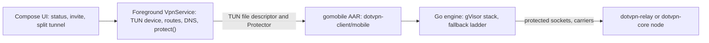

# dotvpn-android

[](https://github.com/payam-foundation/dotvpn-android/actions/workflows/ci.yml)
[](https://github.com/payam-foundation/dotvpn-android/releases)
[](#status)
[](LICENSE)

The Android app of [dotvpn](https://github.com/payam-foundation/dotvpn-wire#related-repositories). Kotlin and Jetpack Compose, minSdk 26, English and Persian (RTL). The tunnel logic is the same Go client as on desktop, bound with gomobile.

## Status

Beta. A live smoke test on an arm64 API 34 emulator passes (TCP and UDP through the tunnel). Only `arm64-v8a` and `x86_64` are built, so 32-bit ARM phones are not supported.

## Features

- One screen: status, connect, active carrier, server list.
- Invite import by `dotvpn://` link, QR scan or paste.
- Per-app split tunnelling.
- Kill switch through the system's Always-on VPN with "Block connections without VPN".
- UDP (QUIC, STUN, other resolvers) rides the tunnel when the node advertises it ([ADR-018](https://github.com/payam-foundation/dotvpn-wire/blob/main/docs/adr/018-udp-over-tunnel-streams.md)).
- No analytics and no crash reporters. Go logs warnings only and persists nothing.

## How it works

Android owns the device, routes and DNS; Go only reads and writes packets on the descriptor it is handed. Every socket the engine opens goes through `VpnService.protect` first, otherwise it would loop into the VPN.



Design: [ADR-019](docs/adr/019-android-shell.md).

## Install

Download `dotvpn.apk` from the [releases page](https://github.com/payam-foundation/dotvpn-android/releases), [verify it](#verify-a-release), and install it. The licence is not an OSI licence, so the app is not eligible for F-Droid; distribute it as a signed APK or through a store you control.

1. Open the app and paste, scan or open an invite from your server operator.
2. Tap Connect and accept the system VPN prompt.
3. For a kill switch: Settings, Always-on VPN, enable it and turn on "Block connections without VPN". The app links there.

## Security model

| Resists | Does not resist |
|---|---|
| Carrier blocking: the Go ladder moves between carriers and reconnects after airplane mode or network switches. | A rooted or compromised device. |
| Leaks while the tunnel is down, if Always-on with "Block connections without VPN" is on. | Leaks if you leave that setting off: Android then falls back to your normal connection. |
| IPv6 leaks: routed into the tunnel and dropped by the user-space stack. | Apps you exclude with split tunnelling. |

The Go `kill_switch` option is ignored on Android. The [lab](https://github.com/payam-foundation/dotvpn-lab#what-a-green-result-means) tests mechanisms, not whether the app works in any given country.

## Verify a release

```sh
cosign verify-blob --bundle checksums.txt.sigstore.json \
  --certificate-identity-regexp 'https://github.com/payam-foundation/dotvpn-android/' \
  --certificate-oidc-issuer https://token.actions.githubusercontent.com checksums.txt
sha256sum -c --ignore-missing checksums.txt
```

Release APKs are signed in CI; the repository holds no keys.

## Upgrade and rollback

Install the new APK over the old one. To roll back, install the previous APK over the new one; settings are additive and stay in app storage.

## Development

Requirements: Go (the version in `../dotvpn-client/go.mod`), JDK 17, Android SDK platform 35 with build-tools, NDK r26 or newer, and gomobile:

```sh
go install golang.org/x/mobile/cmd/gomobile@latest && gomobile init
```

Check out `dotvpn-client` and `dotvpn-wire` next to this repository.

```sh
make vet       # Go side only, no SDK needed
make aar       # build app/libs/dotvpn.aar from ../dotvpn-client/mobile
make apk       # debug APK in app/build/outputs/apk/debug/
make test      # JVM unit tests
make release   # signed release APK; reads DOTVPN_KEYSTORE* from the environment
```

Live smoke test against a node. Gradle's `connectedDebugAndroidTest` uninstalls the app afterwards, which drops the VPN appop, so install and instrument by hand:

```sh
./gradlew assembleDebug assembleDebugAndroidTest
adb install -r -g app/build/outputs/apk/debug/app-debug.apk
adb install -r app/build/outputs/apk/androidTest/debug/app-debug-androidTest.apk
adb shell appops set org.dotvpn.android ACTIVATE_VPN allow
adb shell am instrument -w -e invite 'dotvpn://...' org.dotvpn.android.test/androidx.test.runner.AndroidJUnitRunner
```

It connects, fetches `generate_204` over HTTPS and resolves a name over UDP through the tunnel. The AAR needs `-checklinkname=0`; the reason is in the ADR.

Read [CONTRIBUTING.md](CONTRIBUTING.md) first. Report vulnerabilities as described in [SECURITY.md](SECURITY.md).

## Related repositories

| Repository | Role |
|---|---|
| [dotvpn-wire](https://github.com/payam-foundation/dotvpn-wire) | Shared wire protocol |
| [dotvpn-core](https://github.com/payam-foundation/dotvpn-core) | Server: node, control plane |
| [dotvpn-relay](https://github.com/payam-foundation/dotvpn-relay) | In-country stealth hop |
| [dotvpn-client](https://github.com/payam-foundation/dotvpn-client) | Client library, `dotvpn` CLI, gomobile surface |
| [dotvpn-lab](https://github.com/payam-foundation/dotvpn-lab) | Censorship lab, architecture and ADR index |

## License

[PolyForm Noncommercial License 1.0.0](LICENSE). Source-available, not open source: personal, research, educational and non-profit use is permitted; commercial use needs a separate licence from Payam Foundation.
